<p align="center">
  
</p>

<p align="center"><em>A risk observatory for transaction signals, model decisions, and analyst review</em></p>

> **Project status:** CI checks passing · API tests green · Dashboard build green  
> **Purpose:** Educational and portfolio demonstration. This is not a production payment-risk service.

Sentinel is a full-stack fraud-risk prototype built around a clear operational loop: prepare data, train and evaluate a model, score transactions, review flagged cases, and observe model behavior over time. Its interface uses a dark, image-led “Risk Observatory” visual system with a horizontal navigation dock, telemetry panels, and section-aware browser history.

<p align="center">
  <a href="https://github.com/SAI-SRINIVAS-P/SENTINEL-FRAUD-INTELLIGENCE/actions"></a>
  <a href="#quick-start-docker-recommended"></a>
  <a href="#visual-tour"></a>
  <a href="#api-reference"></a>
</p>

---

## What Sentinel does

| Area | Included capability |
|---|---|
| Model training | ML.NET FastTree binary classifier with a chronological train/validation/test split |
| Evaluation | PR-AUC, precision, recall, F1, accuracy, false-positive rate, confusion matrix, and validation-only threshold comparisons |
| Transaction scoring | Authenticated API scoring with risk probability, configurable decision threshold, and persisted result |
| Review workflow | Pending queue, analyst decision, note, reviewer identity, timestamp, and model-version audit details |
| Model registry | Versioned model artifacts and metadata, active-version information, admin-only retraining and threshold controls |
| Observability | Scoring/flagging/review counts, recent risk distribution, activity timeline, and a simple feature-shift screen |
| Live events | SignalR notifications for flagged and reviewed transactions |
| Security foundation | ASP.NET Identity, JWT authentication, role-gated administrative operations, and failed-login lockout |
| User interface | Responsive React + TypeScript console, anchored section navigation, and browser Back/Forward support |
| Engineering | Docker Compose, SQL Server persistence, xUnit tests, and GitHub Actions CI |

## Website slideshow

The **Sentinel Screen Atlas** below is a locally hosted, automatically cycling six-frame SVG slideshow. It follows the website workflow documented for this project: sign-in, operations overview, live scoring, analyst review, model evaluation, and model health. The artwork is a custom UI reconstruction, not screenshots extracted from the reference recording. Example metrics and transaction IDs are illustrative, not live results.

<p align="center">
  
</p>

<details>
<summary><strong>Slide index · Open a page description</strong></summary>

| Frame | Page | Main purpose |
|---|---|---|
| 01 | Access gateway | Sign-in for analyst and administrator workflows |
| 02 | Operations overview | Scoring activity, flagged cases, pending reviews, and active model |
| 03 | Live scoring | Submit transaction features and inspect the score response |
| 04 | Analyst review | Inspect flagged cases and record review decisions |
| 05 | Evaluation Lab | Review PR-AUC, precision, recall, F1, threshold trade-offs, and confusion matrix |
| 06 | Model health | Inspect registry status, activity signals, and feature-shift screening |

</details>

The title animation and slideshow are original SVG assets created for this repository. SVG animation support can vary between GitHub's file preview, README renderer, and third-party clients; if a viewer shows a static frame, the content remains readable as a still illustration. The reference recording itself was not available as a directly inspectable video file in this editing step, so the slideshow should be treated as a tailored reconstruction of the documented page flow rather than an exact frame-by-frame capture.

## Technology stack

- **Backend:** .NET 10 / ASP.NET Core Web API
- **Machine learning:** ML.NET and FastTree
- **Data and identity:** Entity Framework Core, SQL Server, ASP.NET Identity
- **Authentication:** JWT bearer tokens and role-based authorization
- **Live updates:** SignalR
- **Frontend:** React 19, TypeScript, Vite, Recharts, Lucide
- **Runtime:** Docker, Docker Compose, Nginx
- **Testing and CI:** xUnit and GitHub Actions

## Prerequisites

Install the following before running the project:

| Application | Why it is needed | Official installation |
|---|---|---|
| Git | Clone the repository | [git-scm.com/downloads](https://git-scm.com/downloads) |
| Docker Desktop (Windows/macOS) or Docker Engine + Compose (Linux) | Runs SQL Server, API, and dashboard together | [Docker Desktop](https://www.docker.com/products/docker-desktop/) · [Docker Engine](https://docs.docker.com/engine/install/) |
| .NET 10 SDK | Required for local API development and tests outside Docker | [.NET downloads](https://dotnet.microsoft.com/en-us/download/dotnet/10.0) |
| Node.js 22 LTS | Required for local frontend development | [nodejs.org](https://nodejs.org/en/download) |
| GitHub account (optional) | View source and CI workflow results | [github.com](https://github.com/) |

**Recommended route:** use Docker Compose first. The Docker route avoids having to install SQL Server separately. Allow a few GB of free disk space for container images and the database volume.

## Quick start (Docker, recommended)

### 1. Get the source

```bash
git clone https://github.com/SAI-SRINIVAS-P/SENTINEL-FRAUD-INTELLIGENCE.git
cd SENTINEL-FRAUD-INTELLIGENCE
```

### 2. Configure local environment variables

Copy the example environment file, then set your own local secrets:

**PowerShell**
```powershell
Copy-Item .env.example .env
```

**macOS / Linux**
```bash
cp .env.example .env
```

Open `.env` and set strong local values for `SA_PASSWORD`, `JWT_KEY` (at least 32 bytes), `ADMIN_EMAIL`, and `ADMIN_PASSWORD`. Do not commit `.env`, publish its contents, or reuse local demo credentials in a shared environment.

### 3. Add the dataset

Download the public credit-card fraud benchmark from the [Kaggle dataset page](https://www.kaggle.com/datasets/mlg-ulb/creditcardfraud) or use the original dataset source described in [docs/DATASET.md](docs/DATASET.md). Place the CSV at:

```text
data/raw/creditcard.csv
```

The dataset is intentionally not bundled in Git because it is large and has separate terms of use. If the CSV is absent, the API can start, but model training and meaningful scoring are unavailable.

### 4. Build and start the services

```bash
docker compose up --build -d
docker compose ps
```

Open these local URLs:

- **Dashboard:** http://localhost:3001
- **API:** http://localhost:8081
- **Liveness:** http://localhost:8081/health/live
- **Readiness / database check:** http://localhost:8081/health/ready

The first startup may take several minutes while images are built and SQL Server initializes.

### 5. Sign in and train the model

1. Sign in with the administrator email and password configured in your local `.env`.
2. Open **Model registry**.
3. Choose **Retrain model** and wait for the training response.
4. Confirm that a model version is active and evaluation metrics are present.
5. Open **Live scoring** and submit a row based on the dataset's expected feature schema.
6. Open **Review queue** to inspect a flagged case and record a review decision.

A fresh installation correctly starts without a trained model. It does not fabricate metrics or create a model from all-zero sample features.

## Local development (without Docker)

This route requires .NET 10 SDK, Node.js 22, and a reachable SQL Server. Create/configure `.env` first and use your own secrets and SQL Server connection string.

### Start the API

Set the equivalent environment variables in your shell. Example for PowerShell:

```powershell
$env:ConnectionStrings__FraudDb = "Server=localhost,1434;Database=FraudRisk;User Id=sa;Password=<YOUR_SQL_PASSWORD>;Encrypt=True;TrustServerCertificate=True"
$env:Jwt__Key = "<RANDOM_SECRET_AT_LEAST_32_BYTES>"
$env:Admin__Email = "admin@example.local"
$env:Admin__Password = "<YOUR_LOCAL_ADMIN_PASSWORD>"
$env:ASPNETCORE_URLS = "http://localhost:8081"
$env:ML__DatasetPath = "data/raw/creditcard.csv"
$env:ML__ModelsDirectory = "artifacts/models"

dotnet restore src/Fraud.Api/Fraud.Api.csproj
dotnet run --project src/Fraud.Api/Fraud.Api.csproj
```

### Start the frontend in a second terminal

```powershell
cd web
npm install
npm run dev
```

Open **http://localhost:5173**. The Vite development server proxies API, health, and SignalR requests to the API service.

## Tests and production build checks

From the repository root:

```powershell
dotnet restore tests/Fraud.Api.Tests/Fraud.Api.Tests.csproj
dotnet test tests/Fraud.Api.Tests/Fraud.Api.Tests.csproj --configuration Release

cd web
npm install
npm run build
```

The GitHub Actions workflows run the API test suite and dashboard build. A green build confirms the automated checks passed for that revision; it does not establish that the model is suitable for real-world financial decisions.

## API reference

Except for health checks and authentication entry points, endpoints require a bearer token. Retraining and threshold changes additionally require the Admin role.

| Method | Endpoint | Purpose |
|---|---|---|
| `POST` | `/api/auth/login` | Authenticate and return a JWT |
| `POST` | `/api/auth/register` | Register an Analyst account |
| `POST` | `/api/transactions/score` | Score and persist a transaction |
| `GET` | `/api/transactions?status=Pending&page=1&pageSize=25` | Query the review queue |
| `POST` | `/api/transactions/{id}/review` | Record a review decision and feedback |
| `GET` | `/api/transactions/summary` | Dashboard counters and active model summary |
| `GET` | `/api/transactions/reviews/recent?pageSize=50` | Recent review audit records |
| `GET` | `/api/models` | List model versions |
| `GET` | `/api/models/health` | Active model status and shift screen |
| `GET` | `/api/models/evaluation` | Held-out evaluation metrics |
| `GET` | `/api/models/monitoring` | Recent activity and monitoring aggregates |
| `POST` | `/api/models/retrain` | Train and activate a new model (Admin) |
| `PUT` | `/api/models/threshold` | Update live decision threshold (Admin) |
| `GET` | `/hubs/transactions` | SignalR hub for transaction events |

### Example score request

The feature order follows the benchmark schema: `Time`, `V1` through `V28`, then `Amount`. In the API payload, `time` is seconds from the dataset start, `amount` is the transaction amount, and `v` contains exactly 28 finite numeric values.

```json
{
  "externalId": "demo-tx-001",
  "time": 50000,
  "amount": 2499.00,
  "v": [0, 0, 0, 0, 0, 0, 0, 0, 0, 0, 0, 0, 0, 0, 0, 0, 0, 0, 0, 0, 0, 0, 0, 0, 0, 0, 0, 0]
}
```

This zero vector illustrates request shape only. It is not a realistic transaction and should not be used to assess model quality.

## Repository map

```text
src/Fraud.Api/             ASP.NET Core API, Identity, EF Core, ML.NET, SignalR
  Auth/                    JWT issuance
  Controllers/             Auth, transaction, model lifecycle, evaluation and health
  Data/                    SQL Server EF Core context
  Hubs/                    SignalR events
  Models/                  API contracts and persistence entities
  Services/                Dataset parsing, training, evaluation, monitoring
web/                       React + TypeScript dashboard and Nginx configuration
  src/App.tsx              Main dashboard and workspace navigation
  public/                  Locally hosted interface background SVG assets
tests/Fraud.Api.Tests/     xUnit tests
data/raw/                  Place creditcard.csv here; excluded from Git
artifacts/models/          Versioned model artifacts; excluded from Git
docs/                      Dataset, design, and implementation notes
scripts/                   Local startup helper scripts
.github/workflows/         Continuous integration workflows
```

## Safety, limits, and deployment notes

- This is a research and portfolio prototype, not a payment processor or production fraud-prevention control.
- The public benchmark's `V1`–`V28` columns are anonymized PCA features. They are not interpretable business attributes.
- Single-feature ablation scores are sensitivity indicators, **not causal explanations**.
- Reviewer labels may be mistaken or biased. Treat them as feedback, not verified truth.
- The drift indicator is a basic univariate feature-mean shift screen, not a formal multivariate detector and not proof of performance degradation.
- Threshold changes alter online flagging behavior; stored training metrics do not automatically become metrics for the newly selected threshold.
- Before any shared or production deployment, disable password reset-on-startup behavior, rotate all secrets, use managed secret storage, add EF migrations, rate limiting, account recovery controls, audit retention, rollback gates, load testing, and an independent security review.
- Do not upload real cardholder data or secrets to this repository.

## Project notes

- [Dataset provenance and caveats](docs/DATASET.md)
- [Risk Observatory design notes](docs/RISK-OBSERVATORY-DESIGN.md)
- [UI fixes](docs/UI-FIXES.md)
- [Null-metric rendering fix](docs/NULL-METRICS-FIX.md)

---

<p align="center">
  <strong>SENTINEL</strong><br>
  Observe the signal. Review the evidence. Version the decision.
</p>
